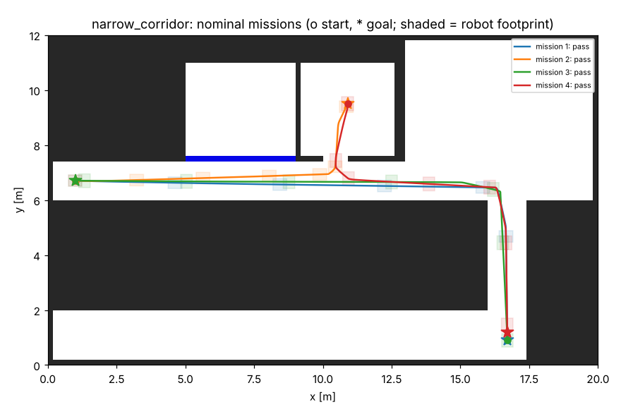

# Robot integration kit

[](https://github.com/vansh0906/robot-integration-kit/actions/workflows/ci.yml)

What a robotics solutions engineer hands a partner: **one navigation stack, configured per partner robot,
with a config linter, an automated qualification suite that writes a customer-ready report, an
integration guide, a training deck, and a feedback log that turns partner problems into product
requirements.**

Three example partners (fictional profiles) on three drive types:

| Partner | Platform | Site | Result |
|---|---|---|---|
| A: warehouse AMR | differential drive, 1.4 m/s | 24 x 14 m warehouse, 1.8 m aisles | PASS 6/6 checks, 50/50 missions |
| B: yard tug | Ackermann (car-like), 2.0 m/s | 30 x 20 m outdoor yard | PASS 6/6 checks, 50/50 missions |
| C: delivery cart | mecanum, 0.8 m/s | office: 1.4 m corridor, 0.9 m doorway, glass partition | PASS 6/6 checks, 48/48 missions |

Each partner runs every agreed condition: nominal, wet floor (about 12 % wheel slip), glass walls the
LiDAR mostly sees through, a person stepping onto the path, E-stop, and 3 s of lost navigation commands.
**148/148 missions, 0 contacts.** The first full run was A 80 %, B 60 %, C 81 %; the 16 issues found on
the way are in [docs/FEEDBACK_LOG.md](docs/FEEDBACK_LOG.md).

Everything is **modeled**: robots, sensors and sites are simulations. The partners are example profiles.



## What's in it

| Piece | Path | What it does |
|---|---|---|
| Partner configs | `configs/partners/*.yaml` | geometry, limits, sensors, sites, conditions, agreed acceptance limits |
| Config linter | `tools/lint_config.py`, `rik/config.py` | 20 checks with partner-facing fixes: units, LiDAR range vs stopping distance, limits physics can't meet |
| Platforms | `rik/platforms.py` | diff drive, Ackermann, mecanum kinematics with actuator limits and slip |
| Base driver | `rik/driver.py` | command watchdog (0.25 s), latched E-stop, deceleration ramp |
| Localization | `rik/localization.py` | EKF [x, y, yaw, gyro bias, odometry scale] + LiDAR scan-to-map matching + IMU slip estimate |
| Planning | `rik/planner.py` | A* for diff/mecanum (footprint-aware smoothing), Hybrid A* for Ackermann |
| Control | `rik/controller.py` | pure pursuit, holonomic crab tracking, obstacle stop along the path, corner slow-down |
| Qualification | `tools/qualify.py`, `rik/qualification.py`, `rik/report.py` | runs every condition, checks Q1-Q6, writes `REPORT.md` + plots + JSON + JUnit |
| C++17 library | `cpp/include/rik/kinematics.hpp` | the same kinematics + watchdog, header-only, for the partner's motor board; checked on 180 golden vectors |
| ROS 2 node | `ros2_ws/src/rik_ros` | `/cmd_vel` -> wheel commands with the same watchdog / E-stop latch |
| Docs | `docs/INTEGRATION_GUIDE.md`, `docs/TRAINING.md`, `docs/FEEDBACK_LOG.md`, `docs/reports/` | for partner engineers and test leads |

## Run it

```bash
pip install -r requirements.txt
python tools/lint_config.py                                    # partner configs
python tools/lint_config.py configs/examples/new_partner_draft.yaml   # a bad first draft: 8 findings
pytest -q tests                                                # 37 tests, ~25 s
python tools/qualify.py --all                                  # 148 missions, ~3.5 min on 2 cores
python tools/qualify.py configs/partners/partner_c_mecanum_cart.yaml --quick
```

Reports land in `results/<partner>/REPORT.md`; copies from the last run are in [docs/reports](docs/reports/SUMMARY.md).

C++ library:

```bash
cmake -S cpp -B build && cmake --build build && ctest --test-dir build --output-on-failure
```

ROS 2 Jazzy:

```bash
cd ros2_ws && colcon build && source install/setup.bash
export PYTHONPATH=$PWD/..:$PYTHONPATH
ros2 launch rik_ros base.launch.py partner:=partner_c_mecanum_cart
```

## Acceptance checks

| ID | Check |
|---|---|
| Q1 | Mission success rate across all conditions |
| Q2 | Localization error, worst run's 95th percentile (nominal, wet floor, glass) |
| Q3 | Minimum clearance between the robot footprint and anything, and zero contacts |
| Q4 | A person steps onto the path: minimum gap at the stop, and the mission resumes |
| Q5 | E-stop stopping distance, and no motion until an explicit reset |
| Q6 | Navigation commands lost: time for the base to stop on its own |

| Partner | Q1 | Q2 | Q3 | Q4 | Q5 | Q6 |
|---|---|---|---|---|---|---|
| A | 100 % | 0.067 m (<= 0.10) | 0.179 m (>= 0.10) | 0.37 m gap | 0.48 m (<= 0.8) | 1.40 s (<= 1.6) |
| B | 100 % | 0.134 m (<= 0.15) | 0.214 m (>= 0.20) | 0.65 m gap | 1.65 m (<= 2.5) | 2.24 s (<= 2.5) |
| C | 100 % | 0.068 m (<= 0.10) | 0.116 m (>= 0.08) | 0.31 m gap | 0.21 m (<= 0.5) | 1.04 s (<= 1.2) |

## CI

* **qualification** (Python 3.11 / 3.12): lint, 37 tests, all 148 missions; reports uploaded as artifacts.
* **cpp** (Ubuntu + macOS): builds with `-Wall -Wextra -Wpedantic -Werror`, 1,276 checks incl. the golden vectors.
* **ros2** (`ros:jazzy-ros-base`): `colcon build` + a `launch_testing` test: drive, watchdog stop, E-stop latch, reset.

## Limits

* Simulation only: a 2-D LiDAR ray caster on 0.1 m grids, kinematic robots with actuator limits and slip.
* Partners are fictional; their acceptance limits are examples. Two were revised during the work
  because the linter showed physics could not meet them (F10, F12 in the feedback log).
* The ROS 2 node is tested in CI only.
