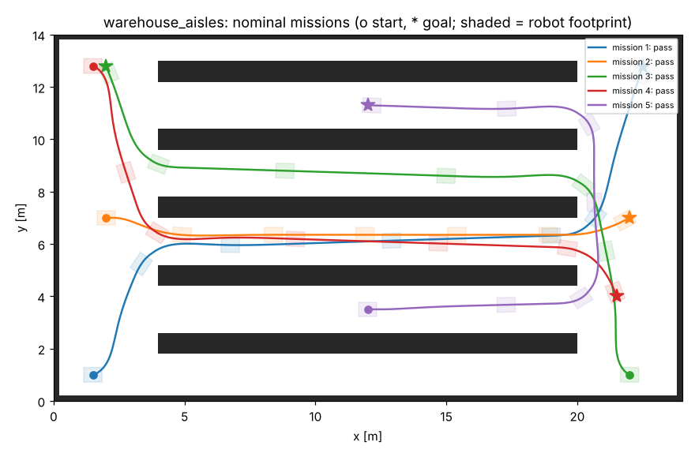

# Qualification report: Partner A (example): warehouse AMR, differential drive

**Verdict: PASS**  
Platform: `diff_drive`, footprint 0.7 x 0.56 m, max 1.4 m/s. Sites: warehouse_aisles. 50 missions across 5 conditions.

All results are from the modeled simulator in this kit, not from the partner's hardware.

## Configuration check

No findings.

## Acceptance checks

| ID | Check | Result | Measured | Agreed limit |
|---|---|---|---|---|
| Q1 | Mission success rate (all conditions) | PASS | 100% (50/50) | >= 95% |
| Q2 | Localization error, worst run p95 | PASS | 0.067 m | <= 0.1 m |
| Q3 | Minimum clearance to walls and obstacles | PASS | 0.179 m, 0 contacts | >= 0.1 m, 0 contacts |
| Q4 | Person steps into the path: stop gap, then resume | PASS | min gap 0.37 m, 10/10 resumed | >= 0.25 m |
| Q5 | E-stop: stopping distance, resume after reset | PASS | max 0.48 m | <= 0.8 m |
| Q6 | Command loss: base watchdog stop time | PASS | max 1.40 s | <= 1.6 s |

## By condition

| Condition | Missions passed | Min clearance | Worst p95 error | Mean time |
|---|---|---|---|---|
| Nominal | 10/10 | 0.188 m | 0.047 m | 23.4 s |
| Wet floor: wheels slip ~12 % | 10/10 | 0.179 m | 0.067 m | 26.4 s |
| Person steps onto the path | 10/10 | 0.187 m | 0.068 m | 28.8 s |
| E-stop pressed mid-mission, released, reset | 10/10 | 0.179 m | 0.060 m | 27.6 s |
| Navigation commands lost for 3 s | 10/10 | 0.187 m | 0.118 m | 26.2 s |

## Missions

Re-run: `python tools/qualify.py /tmp/claude-0/-home-claude/97d63e87-6631-501e-a453-51b7c54a82d2/scratchpad/p34/robot-integration-kit/configs/partners/partner_a_warehouse_amr.yaml`
