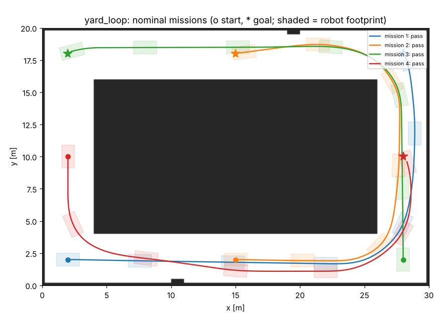

# Qualification report: Partner B (example): yard tug, Ackermann steering

**Verdict: PASS**  
Platform: `ackermann`, footprint 1.8 x 1.0 m, max 2.0 m/s. Sites: yard_loop. 50 missions across 5 conditions.

All results are from the modeled simulator in this kit, not from the partner's hardware.

## Configuration check

No findings.

## Acceptance checks

| ID | Check | Result | Measured | Agreed limit |
|---|---|---|---|---|
| Q1 | Mission success rate (all conditions) | PASS | 100% (50/50) | >= 95% |
| Q2 | Localization error, worst run p95 | PASS | 0.134 m | <= 0.15 m |
| Q3 | Minimum clearance to walls and obstacles | PASS | 0.214 m, 0 contacts | >= 0.2 m, 0 contacts |
| Q4 | Person steps into the path: stop gap, then resume | PASS | min gap 0.65 m, 10/10 resumed | >= 0.4 m |
| Q5 | E-stop: stopping distance, resume after reset | PASS | max 1.65 m | <= 2.5 m |
| Q6 | Command loss: base watchdog stop time | PASS | max 2.24 s | <= 2.5 s |

## By condition

| Condition | Missions passed | Min clearance | Worst p95 error | Mean time |
|---|---|---|---|---|
| Nominal | 10/10 | 0.268 m | 0.134 m | 21.4 s |
| Wet floor: wheels slip ~12 % | 10/10 | 0.269 m | 0.120 m | 24.2 s |
| Person steps onto the path | 10/10 | 0.214 m | 0.201 m | 27.1 s |
| E-stop pressed mid-mission, released, reset | 10/10 | 0.268 m | 0.092 m | 25.5 s |
| Navigation commands lost for 3 s | 10/10 | 0.291 m | 0.172 m | 24.2 s |

## Missions

Re-run: `python tools/qualify.py /tmp/claude-0/-home-claude/97d63e87-6631-501e-a453-51b7c54a82d2/scratchpad/p34/robot-integration-kit/configs/partners/partner_b_yard_tug.yaml`
