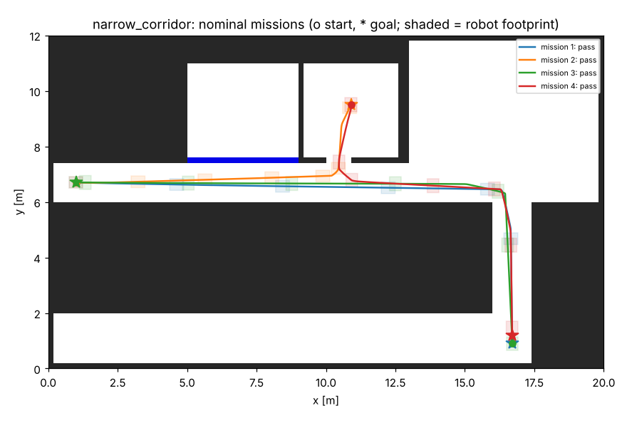

# Qualification report: Partner C (example): office delivery cart, mecanum

**Verdict: PASS**  
Platform: `mecanum`, footprint 0.5 x 0.42 m, max 0.8 m/s. Sites: narrow_corridor. 48 missions across 6 conditions.

All results are from the modeled simulator in this kit, not from the partner's hardware.

## Configuration check

No findings.

## Acceptance checks

| ID | Check | Result | Measured | Agreed limit |
|---|---|---|---|---|
| Q1 | Mission success rate (all conditions) | PASS | 100% (48/48) | >= 95% |
| Q2 | Localization error, worst run p95 | PASS | 0.068 m | <= 0.1 m |
| Q3 | Minimum clearance to walls and obstacles | PASS | 0.116 m, 0 contacts | >= 0.08 m, 0 contacts |
| Q4 | Person steps into the path: stop gap, then resume | PASS | min gap 0.31 m, 8/8 resumed | >= 0.2 m |
| Q5 | E-stop: stopping distance, resume after reset | PASS | max 0.21 m | <= 0.5 m |
| Q6 | Command loss: base watchdog stop time | PASS | max 1.04 s | <= 1.2 s |

## By condition

| Condition | Missions passed | Min clearance | Worst p95 error | Mean time |
|---|---|---|---|---|
| Nominal | 8/8 | 0.116 m | 0.051 m | 25.2 s |
| Glass partitions: LiDAR sees 10 % of glass returns | 8/8 | 0.116 m | 0.042 m | 25.2 s |
| Wet floor: wheels slip ~12 % | 8/8 | 0.130 m | 0.068 m | 28.7 s |
| Person steps onto the path | 8/8 | 0.130 m | 0.050 m | 30.3 s |
| E-stop pressed mid-mission, released, reset | 8/8 | 0.131 m | 0.037 m | 29.2 s |
| Navigation commands lost for 3 s | 8/8 | 0.130 m | 0.050 m | 27.7 s |

## Missions

Re-run: `python tools/qualify.py /tmp/claude-0/-home-claude/97d63e87-6631-501e-a453-51b7c54a82d2/scratchpad/p34/robot-integration-kit/configs/partners/partner_c_mecanum_cart.yaml`
